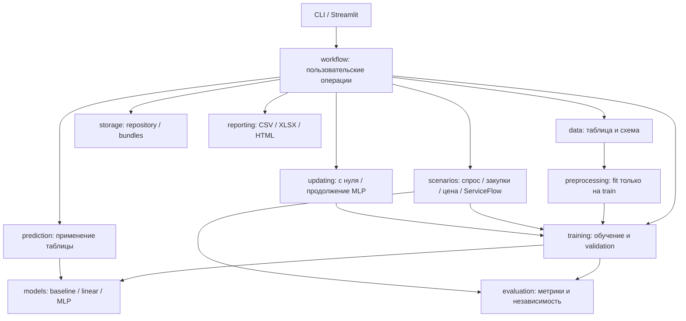

# Архитектура PredictML

Программа — локальный Python-пакет. CLI и Streamlit вызывают операции `workflow.py`. Вычисления работают независимо от интерфейса; общий тренер не выбирает предметный сценарий и не читает файлы.

## Учебный маршрут

| Компонент | Что изучать |
|---|---|
| `config.py` | Единое место настроек обучения, конфигураций моделей, схем экспорта и коэффициентов ценового правила |
| `data.py` | Чтение CSV/XLSX, листы, схема цели и признаков, числовые значения и даты |
| `preprocessing.py` | Импутация, масштабирование, категории/даты; обучение преобразований только на train |
| `models.py` | MLP и применение унифицированного состояния baseline/linear/MLP |
| `training.py` | Разбиение, оптимизация, early stopping, обучение кандидатов, выбор по validation |
| `evaluation.py` | Общие метрики, отпечатки наблюдений, независимый контроль загруженных моделей |
| `prediction.py` | Сохранённая схема, предобработчик и применение выбранного checkpoint к новой таблице |
| `scenarios/demand.py` | Полные месяцы, причинные лаги, рекурсия, временная оценка и постановка обучения спроса |
| `scenarios/materials.py` | Нормативы, расход, остатки, шаг покупки и стоимость |
| `scenarios/price.py` | Признаки цены, разбиение, формула и интерпретация предсказанного отношения |
| `scenarios/serviceflow.py` | Контракты предметных CSV/JSON, проверка и подготовка экспорта |
| `updating.py` | Переобучение и продолжение MLP с фиксированным пространством признаков |
| `workflow.py` | Операции train/predict/compare/update, загрузка версий, регистрация и запись результатов |
| `storage/repository.py` | SQLite, транзакции, история запусков и неизменяемые версии |
| `storage/bundles.py` | Manifest, описание комплекта, контроль целостности и сериализация |
| `reporting.py` | Представление готовых результатов и экспорт таблиц/метрик |
| `ui/app.py`, `ui/launcher.py`, `cli.py` | Экраны, ввод параметров, запуск и сообщения |
| `demo.py`, `data/examples/` | Единственная копия синтетических примеров и экспорт рабочей копии командой demo |

`workflow` связывает готовые вычислительные функции и хранилище. Он содержит файловые операции, а `training`, `updating` и функции контрольной оценки работают с уже загруженными объектами. У `TabularModel` остались удобные методы save/load, которые делегируют сериализацию `storage/bundles.py`; обучение и файловые пользовательские операции вынесены из класса.

## Совместимость

Переходные модули с прежними путями импортов удалены. `models.py` содержит MLP и Predictor; отдельного пакета `models/` и пакета `tabular/` больше нет. Новый код использует только пути из таблицы выше.

Загрузка старых joblib выполняется через `compatibility/serialization.py`: локальный загрузчик сопоставляет старые пути классов TabularModel, Preprocessor, TableConfig и MLP с текущими. Он не создаёт глобальных подмен Python-модулей. Адаптер использует форматный загрузчик joblib, проверенный на закреплённой версии 1.6.0; минимальная зависимость поднята до 1.6. Формат комплектов и схема SQLite сохранены.

Исходный относительный прогноз материалов остаётся в `compatibility/materials.py`, старый тренер — в `compatibility/legacy.py`. Это исполняемая предметная логика исторического режима, а не пустые оболочки. Основной сценарий спроса использует demand-v2.

## Правила вычислений

Случайное разбиение используется только в обычной таблице; временной режим требует явной постановки и отсечения неизвестных целей. Спрос — отдельный месячный контракт demand-v2: только полные месяцы, раздельные ряды, три лага и train-only нормировка. Validation выбирает лучшие веса; test и отдельный контроль не обновляют параметры. Методика и формулы при рефакторинге сохранены.

Один Store содержит `history.sqlite3` и `runs/<UUID>`. У каждой версии — manifest/payload, сохранённый предобработчик либо нормировка. Плоские файлы последнего результата являются заменяемыми копиями; зарегистрированные версии неизменяемы.

Продолжение MLP использует сохранённые веса, архитектуру и предобработчик с новым Adam. Переобучение создаёт новые веса/OLS и train-статистики. Provenance отклоняет пересекающийся или непроверяемый контроль; это проверка зарегистрированных наблюдений, а не доказательство происхождения внешних данных.

Границы: CPU, локальная работа, числовая регрессия. Автоматическая рекурсия ограничена месячным спросом 1–3 месяца; общий временной режим принимает заранее подготовленную цель. Экспорт из живой базы ServiceFlow и реальные бизнес-данные этим рефакторингом не добавлены.
