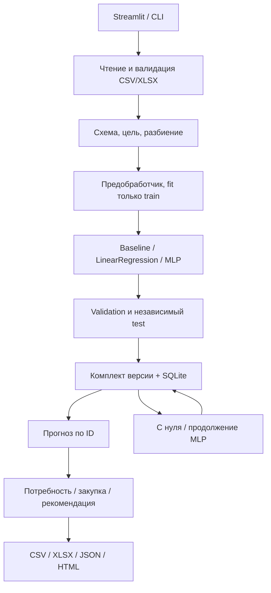

# Архитектура PredictML 0.1

Программа — локальный Python-пакет. CLI и Streamlit вызывают одно ядро; ядро не импортирует Streamlit. Модель создаётся под выбранную схему, сохранённый комплект применяется только к совместимым данным.

| Компонент | Ответственность |
|---|---|
| tabular/io, schema, preprocessing | CSV/XLSX/листы, семантическая схема, импутация/масштабирование/категории/даты |
| tabular/application | Универсальное обучение и применение сохранённого конвейера |
| models/mlp, regressors, training, metrics | Общая MLP, OLS/baseline, оптимизация/early stopping, метрики |
| preparation, contracts | Контракты ServiceFlow и перенос Ruby-подготовки |
| demand, demand_pipeline, purchasing | Причинные временные признаки, рекурсия/оценка, отдельный расчёт закупки |
| scenarios, comparison | Предметные сценарии и корректное сравнение; legacy-политики отделены явно |
| storage | SQLite-запуски и версии, manifest, контрольные суммы, совместимость, экспорт |
| updates, provenance, version_comparison | Переобучение, фиксированное продолжение, lineage и проверяемый общий контроль |
| ui, cli | Пользовательские действия и сообщения; без собственных ML-алгоритмов |
| demo, data/examples | Синтетические данные внутри устанавливаемого пакета |

Время и данные: случайное разбиение используется только в обычной таблице; временной режим требует явной постановки и отсечения неизвестных целей. Спрос — отдельный месячный контракт demand-v2: только полные месяцы, раздельные ряды, три лага и общий train-only scaler. Validation выбирает лучшие веса; test и отдельный контроль не обновляют параметры.

Хранение: один каталог Store содержит history.sqlite3 и runs/<UUID>. У каждой модели — отдельный manifest/payload, скопированный предобработчик либо сохранённая нормировка. Старые плоские файлы — заменяемые копии последнего результата. Версии создаются добавлением, а не изменением прежних файлов. Состояние формы UI не заменяет состояние модели.

Продолжение MLP: сохранённые веса и архитектура, предобработчик фиксирован, Adam новый. Переобучение: новые веса/OLS и новые train-статистики. Разные цели/признаки означают отдельную модель. Provenance позволяет отклонять пересекающийся/непроверяемый контроль; это проверка зарегистрированных наблюдений, не доказательство происхождения внешних данных.

Границы: CPU, локальная работа, числовая регрессия. Нет облака, ролей, AutoML, классификации, streaming/distributed обучения. Автоматическая рекурсия ограничена месячным спросом 1–3 месяца; общий временной режим принимает заранее подготовленную цель.
